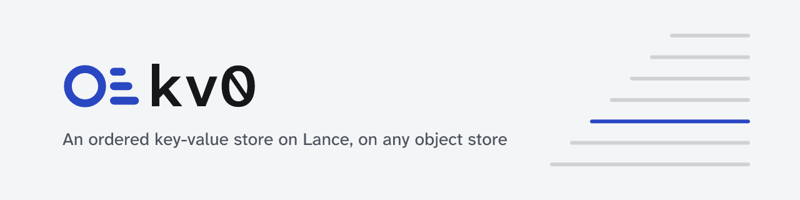

<p align="center">
  <picture>
    <source media="(prefers-color-scheme: dark)" srcset="assets/banner-dark.png">
    
  </picture>
</p>

<p align="center">
  <b>An ordered key-value store and experiment-tracking tables on Lance.</b><br>
  One embedded engine for a local disk, S3, Google Cloud Storage and Azure, from Rust and Python.
</p>

<p align="center">
  <a href="https://sayef.github.io/kv0/">Docs</a> ·
  <a href="https://sayef.github.io/kv0/getting-started/">Getting started</a> ·
  <a href="https://sayef.github.io/kv0/concepts/">Concepts</a> ·
  <a href="bench/MEMORY-REPORT.md">Benchmarks</a> ·
  <a href="CHANGELOG.md">Changelog</a>
</p>

kv0 is a library, not a server. Open a database by path or URI and you have an ordered key-value
store: keys sort byte-wise, `WriteBatch`es commit atomically, and iterators `seek` and
`seek_for_prev`. Next to it, typed tables for runs, parameters and metric series hold an experiment
tracker's data on the same storage.

## Why kv0

- **One engine on every backend.** Data is a [Lance](https://lance.org) dataset, so the same code
  runs on a laptop and straight on a bucket. No sync daemon, no storage protocol of its own.
- **Several writers, no coordinator.** Processes on one machine or many append at once; every
  commit is an atomic, versioned Lance commit, and any version can be opened again.
- **A write survives a killed process.** It is in a local write-ahead log before the call returns,
  and the next open replays what was not committed yet.
- **Memory and open time stay bounded.** One compact entry per key in memory, values over 4 KiB
  left in Lance, and a view snapshot that opens 10M keys in 0.7 s.
- **Measured, regressions included.** Every number below links to its table and method.

## Install

```sh
pip install kv0          # Python 3.11+; until the first release: maturin develop --release
cargo add kv0            # Rust; building needs protoc (protobuf-compiler, libprotobuf-dev)
```

## Quickstart

```python
import kv0

db = kv0.DB("/tmp/example_db")             # or "s3://bucket/prefix/db", storage_options={...}

batch = kv0.WriteBatch()
batch.put(b"run/7/loss/0001", b"0.31")
batch.put(b"run/7/loss/0002", b"0.25")
db.write(batch)                             # atomic; visible now, committed in the background

it = db.iteritems()
it.seek(b"run/7/")
for key, value in it:
    print(key, value)

db.close()                                  # commits what is buffered
```

```rust
use kv0::kv::{Db, Options, WriteBatch};

let db = Db::open("/tmp/example_db", Options::default())?;
let mut batch = WriteBatch::new();
batch.put(b"run/7/loss/0001", b"0.31").put(b"run/7/loss/0002", b"0.25");
db.write(batch)?;

let mut it = db.iter();
it.seek(b"run/7/");
for (key, value) in it {
    println!("{key:?} = {value:?}");
}
db.close()?;
```

Tracking tables, from Python or with an async Rust API for servers:

```python
from kv0.tracking import Repo

repo = Repo("s3://bucket/tracking")
with repo.create_run(name="baseline", experiment="demo") as run:
    run["hparams"] = {"lr": 3e-4}
    for step in range(1000):
        run.track(1.0 / (step + 1), name="loss", context={"subset": "train"})

repo.metric(run.id, "loss", context={"subset": "train"}, start=900, stop=1000)
```

## Benchmarks

One machine (i5-13500, NVMe), local disk, medians of five runs; a difference counts only when the
ranges do not overlap and the medians differ by more than 20%.

| | Before the memory work | Now |
|---|---:|---:|
| Reopen 1M / 10M keys | 451 ms / 5.57 s | 74 ms / 705 ms |
| Memory after reopen, 1M / 10M keys | 547 MB / 3.1 GB | 151 MB / 1.0 GB |
| 100k × 16 KiB values: reopen | 886 ms, 2.6 GB | 20 ms, 90 MB |
| Seek + 100 × next, p50 | 25 µs | 11 µs |
| Crash recovery, 200k unflushed puts | 173 ms | 218 ms (worse) |

[bench/MEMORY-REPORT.md](bench/MEMORY-REPORT.md) has every cell; [bench/REPORT.md](bench/REPORT.md)
compares kv0 with a SQLite-cache baseline on writes (51× more puts per second on the tracker
workload), reads, scans, S3 requests and crash recovery, and names where kv0 is worse.

## Documentation

- [Docs](https://sayef.github.io/kv0/): getting started, concepts, guides, FAQ.
- [DESIGN.md](DESIGN.md): storage format, durability, compaction, concurrency, rejected
  alternatives.
- [CONTRIBUTING.md](CONTRIBUTING.md): development setup and tests.
- [brand/DESIGN.md](brand/DESIGN.md): the mark, colours and type.

## License

[Apache License 2.0](LICENSE).
