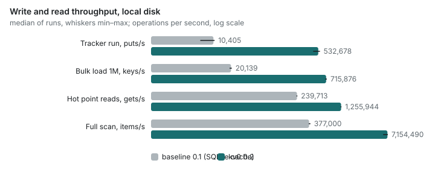
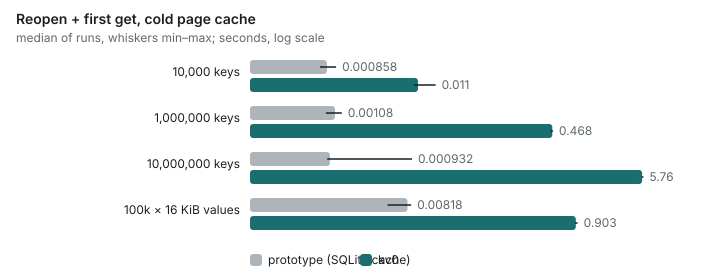
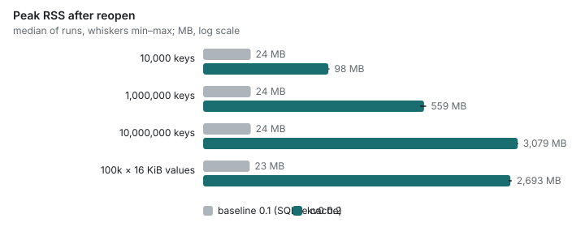
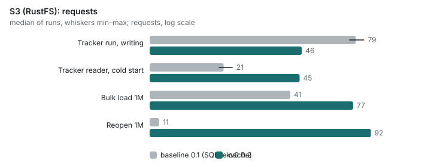

# kv0 0.2 against 0.1: evaluation

The question: is kv0 0.2 (Rust, Lance, local write-ahead log) significantly better than 0.1
(pure Python, a local SQLite file per database, optional S3 sync of segment files)? Everything here is
reproducible with `python bench/eval/run_all.py` followed by `python bench/eval/report.py`; raw
results are in `bench/eval/results.jsonl`.

## Method

**Machine.** Intel Core i5-13500 (6 P-cores + 8 E-cores, 20 threads), 62 GB RAM, two Samsung PM9A1
NVMe drives in software RAID (md), Linux 6.12 (Debian), Python 3.13. One machine for everything.
kv0 0.2 is the release build (thin LTO) of this repository; 0.1 is the last pure-Python version,
installed in its own virtual environment.

**S3.** RustFS (an S3-compatible server) in Docker on the same machine, behind a small counting
proxy (`bench/eval/s3proxy.py`) so request counts are exact for both versions. Latency is loopback,
so S3 timings are a lower bound; request counts carry over to real S3 directly. 0.1 talks to S3
through its own sync layer (`KV0_S3_*`, background flush every 5 s, `flush()`/`close()` push);
0.2 opens `s3://…` through Lance.

**Durability.** 0.1's SQLite runs in WAL mode with `synchronous=NORMAL`: every write
is in the SQLite log before it returns (it survives a killed process) but is not fsynced, so a power
loss can lose recent writes. 0.2's default `wal_sync="batch"` is the same guarantee class (written to
the OS before returning, fsync about every 100 ms), so **0.1 against 0.2 default is the like-for-like
comparison**. `wal_sync="always"` fsyncs every write, which is *stronger* than 0.1; it is included as
asked, on the smaller workloads (an fsync costs about 6 ms on this disk).

**Repetitions and statistics.** Every cell runs 5 times, each in a fresh process (write cells on a
fresh database). Tables give the median and the min–max range. A difference is **better** or
**worse** only when the two ranges do not overlap (for 5 against 5 that is the most extreme
Mann–Whitney U, two-sided p = 0.008) *and* the medians differ by more than 20%; otherwise it is
"same" or "not significant". Read-cell datasets are built once per engine and size and reused.
"Cold" cells run in a new process after evicting the dataset files from the page cache with `posix_fadvise(DONTNEED)` (`/proc/sys/vm/drop_caches` is read-only in this container); "hot" is a second pass in
the same process.

**Workloads** (synthetic data only):

- **Tracker run (a).** The key-value traffic of an experiment tracker logging one training run,
  synthesised: 20 series (10 metrics × 2 contexts) × 5000 steps. Per tracked value the tracker
  writes three puts to the run's `seqs` database (`val`, `epoch`, `time`, keyed by step) and two to
  its `meta` database (`last`, `last_step`), plus `min`/`max` when they change and four puts when a
  series starts: about 520 000 single-key puts into two databases, then `close()`. The **tracker
  reader** part opens both databases read-only in a new process (cold page cache), lists the run's
  metadata (full scan of `meta`), reads every series (seek to the `val` and `time` prefixes and
  iterate to the end) and reads each series' `last`. A **small tracker run** (200 steps, about
  21 000 puts) is used where every write is fsynced.
- **Bulk load (b).** 1 000 000 tracker-shaped keys (8-byte values) in `WriteBatch`es of 1000, then
  `close()`.
- **Point reads (c).** 20 000 random `get`s on a 1M-key database: cold (first pass after opening in a
  new process with the dataset evicted from the page cache) and hot (second pass).
- **Range scans (d).** 200 × (`seek` to a random prefix + 100 `next()`), and one full scan.
- **Reopen / cold start (e).** Open an existing database in a new process (dataset evicted from the page cache) and
  read one key, at 10 000, 1 000 000 and 10 000 000 keys (S3: 10 000 and 1 000 000, from a new empty
  local directory, which is a new machine for 0.1). Plus **large values**: 100 000 × 16 KiB.
- **Two writers (f).** Two processes write 200 000 keys each (batches of 100) to one database at the
  same time; a third process then counts what is visible.
- **Crash recovery (g).** A process writes 200 000 single puts, never flushes and SIGKILLs itself; the
  reopen that recovers is timed and the recovered keys counted.

Measured: throughput, p50/p99 latency per operation, peak RSS (`ru_maxrss`), bytes on disk (or in the
bucket) and S3 requests.

Repetitions per cell: 5. Dataset files evicted from the page cache before cold cells: yes. Python 3.13.18.

## Verdict

**0.2 is significantly better at everything that moves data** (writing, reading, scanning,
concurrent writers, S3 traffic for a training run) and **significantly worse at memory, cold start
and storage overhead for large values**. Both directions are large, not marginal. Every row below
is consistent across 5 repetitions (non-overlapping ranges, more than 20% apart) unless marked.

| Workload | Like for like (0.1 vs 0.2 default, local) | On S3 (RustFS) | Verdict |
|---|---|---|---|
| (a) Tracker run, writing (≈520k puts) | 10.4k → 533k puts/s (**51×**); p99 88 → 2.5 µs | 10.6k → 276k puts/s (**26×**); 79 → 46 requests | better |
| (a) Tracker run, writer memory | 43 → 287 MB (**6.7× worse**) | 85 → 301 MB (3.6× worse) | worse |
| (a) Tracker reader session (open, list, read 20 series, cold cache) | 373 → 192 ms (**1.9×**); opening alone 1 → 167 ms (worse) | 1.83 s → 376 ms (**4.9×**); 21 → 45 requests (worse) | better overall |
| (b) Bulk load 1M keys | 20k → 716k keys/s (**36×**); 137 → 65 MB on disk | 18k → 199k keys/s (**11×**); 41 → 77 requests (worse) | better |
| (c) Point reads, hot | 240k → 1.26M gets/s (**5.2×**), p99 5.4 → 1.2 µs | 249k → 1.22M (**4.9×**) | better |
| (c) Point reads, cold page cache | p50 96 µs → 0.7 µs (**130×**), but open 0 → 455 ms | open 2.96 s → 0.77 s (**3.8× better**) | better per read, worse to open |
| (d) Range scans | seek+100 p50 498 → 24 µs (**21×**); full scan 0.38M → 7.2M items/s (**19×**) | p50 58 → 24 µs (2.4×); p99 not significant | better |
| (e) Reopen, 10k / 1M / 10M keys | 1 ms → 11 ms / **468 ms** / **5.8 s** | 10k: 173 → 135 ms; 1M: 3.6 s → 0.8 s (**4.4× better**) | worse locally, better on S3 |
| (e) Memory after reopen, 10k / 1M / 10M | 24 MB → 98 MB / **559 MB** / **3.08 GB** | 120 → 685 MB at 1M | worse |
| (e) Large values, 100k × 16 KiB | load 7.0k → 5.2k/s (**25% worse**); reopen 8 ms → 903 ms; RSS 23 MB → **2.7 GB**; disk 1.70 → **4.85 GB** | not measured | worse |
| (f) Two concurrent writers | 395k → 1.0M keys/s (**2.6×**); all 400k visible in both | 129k → 191k keys/s (48%); all visible | better |
| (g) Crash recovery, 200k unflushed puts | all 200k recovered by both; reopen 0.5 ms → 164 ms | — | same data, slower reopen |

**Stronger durability (`wal_sync="always"`, fsync per write)** is not what 0.1 offered (0.1 never
fsynced a put): on the small tracker run it is **94× slower than 0.1** (15.3k → 163 puts/s, p99 21 µs →
13 ms, an fsync on this disk); on bulk loads, where one fsync covers 1000 keys, it is still
**4.5× faster** than 0.1 (20k → 90k keys/s). Recovery after SIGKILL at 20k fsynced puts recovers all.

### The regressions, named

1. **Memory.** 0.2 keeps every live key and value in an in-memory ordered map. Peak RSS is
   20–130× 0.1's at the same data: 559 MB at 1M small keys, 3.1 GB at 10M, 2.7 GB for 1.6 GB of
   values. 0.1's SQLite file kept RSS at 24 MB regardless of size. This is the largest regression
   and it scales with data, not with load.
2. **Cold start.** Opening reads the whole operation log into that map: 0.47 s at 1M keys, 5.8 s
   at 10M, 0.9 s for 1.6 GB of values, against about 1 ms for 0.1 locally. (On S3 0.2 still wins,
   because 0.1 has to download and merge segments into a new local cache.)
3. **Storage overhead for large values.** Automatic compaction rewrites fragments, and the
   superseded files stay until version cleanup (7-day retention by default): 4.85 GB on disk for
   1.70 GB of incompressible values, 2.9× 0.1. For small tracker-shaped values Lance's encoding wins
   instead (65 MB against 137 MB).
4. **Synchronous durability.** `sync=True` (commit to Lance) and `wal_sync="always"` (fsync each
   write) cost an fsync or a Lance commit per call; 0.1 offered neither guarantee, so there is no
   like-for-like row, but code that relies on them is 10²–10³× slower per write.
5. **S3 requests on bulk load and reopen.** 77 against 41 requests for a 1M bulk load, 92 against
   11 to reopen 1M keys (Lance reads manifests, fragment metadata and data files separately). A
   training run writes with fewer requests (46 against 79).
6. **Crash recovery** replays and commits the WAL on open: 164 ms for 200k writes, where 0.1 had
   nothing to recover. Correctness is equal (all acknowledged writes come back in both).

### Is 0.2 significantly better?

For the workload kv0 exists for (an experiment tracker writing metrics and a reader opening them),
**yes**: writes are 26–51× faster, UI sessions 2–5× faster, scans and reads 5–20× faster, and
concurrent writers and S3 work correctly with fewer requests while training. It is **not** better
for a process that opens large databases often or must run in little memory: at 10M keys it needs
3 GB and 6 s to open what 0.1 opened in 1 ms with 24 MB.

### Decision: fix memory and reopen natively

Regressions 1–2 come from one design choice: the whole view in process memory, rebuilt from Lance
on every open. I keep that design (the in-memory view, the local WAL and Lance) and do not add
a second storage engine, so the fixes stay inside it:

- **Large values out of the view.** Values above a size threshold stay in Lance and are fetched by
  row id on demand, through a bounded cache. This targets the 2.7 GB of large-value memory.
- **Compact keys and entries.** Less per-entry overhead in the view, which targets the 3.1 GB at
  10M small keys.
- **A snapshot for reopen.** A compact snapshot of the view, tagged with the Lance version it
  reflects, is loaded at open, and only fragments committed since are applied. This targets the
  5.8 s reopen.
- **Storage (regression 3)** is separate: compaction should clean up the versions it supersedes
  once readers no longer need them, instead of waiting for the retention period.

I built and measured an SQLite local tier as an alternative. It fixed memory and reopen (10M keys:
56 MB and 4 ms) but cost 7–22× throughput and slower crash recovery, so I dropped it. The
record is in [docs/design/sqlite-tier-experiment.md](../docs/design/sqlite-tier-experiment.md).
I rejected RocksDB, LMDB, redb and fjall as well; Lance stays the durable, shared source of truth.

## The tracker's scale scenario

An experiment tracker built on kv0 reported that logging 2,000 runs took 27 minutes, because each commit
slowed down as fragments accumulated, and that its server took 250–386 s to start against an
uncompacted repository. `bench/eval/scale.py` reproduces the shape of that test through the
tracking API alone:

- 2,000 runs in 20 experiments, each with parameters and three series (`loss[train]` at every
  step, `loss[val]` and `accuracy[val]` at every tenth step);
- one commit per run (`finish`, then `flush`), as the tracker's SDK does;
- a cold start that lists the runs and reads each run's parameters and series, as the tracker's
  first catalog refresh does.

"Before" is `b498409`, the build the tracker measured: no automatic compaction in the tracking
layer. "After" is `main`, which compacts small fragments in the background after a flush.

The per-run cost is the clearest signal. Before, a commit's cost grows with the number of
fragments: the last tenth of the runs took about 8× as long as the first. After, background
compaction keeps the fragment count bounded, and the last tenth took about 2× as long as the
first. Start-up gains for the same reason: each per-run scan reads a few compacted fragments
instead of 2,000 small ones.

Start-up still makes two filtered scans per run. With the bulk reads (`runs`, `all_params`,
`all_series` and `series_stats`, one scan each) the same start-up takes 0.07 s instead of 10–25 s
(`bench/eval/results-scale-v2.jsonl`, one repetition). Series statistics are stored as delta rows
in the same commit as the points, and a flush checks for deleted runs at most once a second:
logging the 2,000 runs takes 63 s (92 s on main, measured on another day on this shared machine),
and the last tenth of the runs 0.04 s per run. On the resulting 4.8M points, `optimize` takes
2.1 s the first time (a full sorted rewrite, which every call did before), 0.02 s when nothing was
added, and 0.3 s after one more run of 2,000 points.

This machine logs faster than the tracker's run (4.5 minutes before against their 27), because
the tracker's SDK adds its own work per point. The ratios are what carries over.

2,000 runs of 2,000 steps, 4.8 M points, one repetition per build.

| | before (b498409) | after (main) | Change |
|---|---:|---:|---:|
| Logging 2,000 runs (one commit per run) | 267 s | 92 s | 2.9× better |
| Per run, first tenth of the runs | 0.04 s | 0.03 s | 1.1× better |
| Per run, last tenth of the runs | 0.30 s | 0.06 s | 4.8× better |
| Start-up: open and read every run's params and series | 216 s | 20 s | 10.7× better |
| Start-up: peak RSS | 4,779 MB | 851 MB | 5.6× better |

## Charts

## Tables: local, 0.2 default (wal_sync="batch")

| Workload | Size | baseline 0.1 median [min–max] | kv0 0.2 median [min–max] | Change | Verdict |
|---|---|---:|---:|---:|---|
| Tracker run: puts | 5,000 | 10,405 [6,346–10,875] | 532,678 [440,393–567,530] | 51.2× better | **better** |
| Tracker run: put p50 | 5,000 | 23.7 µs [20.5 µs–28.1 µs] | 0.9 µs [0.9 µs–0.9 µs] | 25.8× better | **better** |
| Tracker run: put p99 | 5,000 | 87.7 µs [86.0 µs–94.7 µs] | 2.5 µs [2.1 µs–2.9 µs] | 35.5× better | **better** |
| Tracker run: close (final flush) | 5,000 | 35 ms [32 ms–76 ms] | 31 ms [26 ms–63 ms] | 14% better | same |
| Tracker run: writer peak RSS | 5,000 | 43 MB [42 MB–43 MB] | 287 MB [271 MB–311 MB] | 6.7× worse | **worse** |
| Tracker run: stored size | 5,000 | 37 MB [37 MB–37 MB] | 22 MB [22 MB–22 MB] | 72% better | **better** |
| Tracker run: S3 requests while writing | 5,000 | 0 [0–0] | 0 [0–0] |  | n/a |
| Tracker reader: open both DBs (cold) | 5,000 | 1 ms [1 ms–1 ms] | 167 ms [162 ms–174 ms] | 196.4× worse | **worse** |
| Tracker reader: list run metadata | 5,000 | 1 ms [1 ms–1 ms] | 0 ms [0 ms–0 ms] | 20.0× better | **better** |
| Tracker reader: read one series (val+time) p50 | 5,000 | 12.3 ms [12.1 ms–13.0 ms] | 1.2 ms [1.2 ms–1.2 ms] | 10.5× better | **better** |
| Tracker reader: whole session | 5,000 | 373 ms [373 ms–394 ms] | 192 ms [188 ms–198 ms] | 95% better | **better** |
| Tracker reader: S3 requests | 5,000 | 0 [0–0] | 0 [0–0] |  | n/a |
| Small tracker run: puts | 200 | 15,270 [14,526–15,434] | 780,008 [770,165–806,758] | 51.1× better | **better** |
| Small tracker run: put p99 | 200 | 20.8 µs [19.0 µs–28.6 µs] | 1.8 µs [1.8 µs–1.9 µs] | 11.6× better | **better** |
| Bulk load 1M (batches of 1000) | 1,000,000 | 20,139 [19,072–20,749] | 715,876 [690,349–734,538] | 35.5× better | **better** |
| Bulk load: batch p99 | 1,000,000 | 115.2 ms [96.3 ms–121.7 ms] | 17.9 ms [17.5 ms–18.4 ms] | 6.4× better | **better** |
| Bulk load: peak RSS | 1,000,000 | 23 MB [23 MB–23 MB] | 428 MB [428 MB–440 MB] | 18.3× worse | **worse** |
| Bulk load: stored size | 1,000,000 | 137 MB [137 MB–137 MB] | 65 MB [65 MB–65 MB] | 2.1× better | **better** |
| Bulk load: S3 requests | 1,000,000 | 0 [0–0] | 0 [0–0] |  | n/a |
| Point reads: open (cold cache) | 1,000,000 | 0 ms [0 ms–0 ms] | 455 ms [437 ms–473 ms] | 1035.8× worse | **worse** |
| Point reads cold: get p50 | 1,000,000 | 96.2 µs [93.8 µs–97.5 µs] | 0.7 µs [0.7 µs–0.8 µs] | 131.7× better | **better** |
| Point reads cold: get p99 | 1,000,000 | 259.4 µs [256.3 µs–285.7 µs] | 1.2 µs [1.2 µs–1.3 µs] | 208.7× better | **better** |
| Point reads hot: gets | 1,000,000 | 239,713 [234,896–243,176] | 1,255,944 [1,230,733–1,273,643] | 5.2× better | **better** |
| Point reads hot: get p99 | 1,000,000 | 5.4 µs [5.2 µs–5.5 µs] | 1.2 µs [1.2 µs–1.2 µs] | 4.6× better | **better** |
| Point reads: peak RSS | 1,000,000 | 24 MB [24 MB–24 MB] | 566 MB [527 MB–601 MB] | 23.8× worse | **worse** |
| Range scan: seek + 100 next p50 | 1,000,000 | 497.9 µs [439.1 µs–633.1 µs] | 24.2 µs [24.1 µs–25.4 µs] | 20.5× better | **better** |
| Range scan: seek + 100 next p99 | 1,000,000 | 9.1 ms [8.9 ms–9.3 ms] | 189.3 µs [39.0 µs–219.7 µs] | 48.2× better | **better** |
| Full scan | 1,000,000 | 377,000 [371,831–397,000] | 7,154,490 [6,091,972–7,257,178] | 19.0× better | **better** |
| Reopen + first get (cold cache) | 10,000 | 1 ms [1 ms–1 ms] | 11 ms [10 ms–18 ms] | 12.8× worse | **worse** |
| Reopen + first get (cold cache) | 1,000,000 | 1 ms [1 ms–1 ms] | 468 ms [447 ms–475 ms] | 434.7× worse | **worse** |
| Reopen + first get (cold cache) | 10,000,000 | 1 ms [1 ms–9 ms] | 5.76 s [5.69 s–5.98 s] | 6177.9× worse | **worse** |
| Reopen: peak RSS | 10,000 | 24 MB [24 MB–24 MB] | 98 MB [98 MB–100 MB] | 4.1× worse | **worse** |
| Reopen: peak RSS | 1,000,000 | 24 MB [24 MB–24 MB] | 559 MB [521 MB–581 MB] | 23.5× worse | **worse** |
| Reopen: peak RSS | 10,000,000 | 24 MB [24 MB–24 MB] | 3,079 MB [3,037 MB–3,100 MB] | 129.3× worse | **worse** |
| Reopen: S3 requests | 10,000 | 0 [0–0] | 0 [0–0] |  | n/a |
| Reopen: S3 requests | 1,000,000 | 0 [0–0] | 0 [0–0] |  | n/a |
| Reopen: S3 requests | 10,000,000 | 0 [0–0] | 0 [0–0] |  | n/a |
| Large values (100k × 16 KiB): load | 100,000 | 6,986 [6,623–7,732] | 5,224 [4,236–5,699] | 34% worse | **worse** |
| Large values: reopen | 100,000 | 8 ms [5 ms–9 ms] | 903 ms [883 ms–949 ms] | 110.4× worse | **worse** |
| Large values: reopen peak RSS | 100,000 | 23 MB [23 MB–23 MB] | 2,693 MB [2,611 MB–2,761 MB] | 115.2× worse | **worse** |
| Large values: stored size | 100,000 | 1,696 MB [1,696 MB–1,696 MB] | 4,852 MB [4,852 MB–4,852 MB] | 2.9× worse | **worse** |
| Two writers: combined keys | 200,000 | 394,556 [366,480–413,777] | 1,008,711 [967,883–1,068,408] | 2.6× better | **better** |
| Two writers: keys visible after | 200,000 | 400,000 [400,000–400,000] | 400,001 [400,001–400,001] | 0% better | same |
| Crash recovery: reopen after SIGKILL | 200,000 | 0 ms [0 ms–1 ms] | 164 ms [162 ms–174 ms] | 347.0× worse | **worse** |
| Crash recovery: keys recovered of 200k | 200,000 | 200,000 [200,000–200,000] | 200,000 [200,000–200,000] | 0% better | same |

## Tables: local, 0.2 wal_sync="always"

| Workload | Size | baseline 0.1 median [min–max] | kv0 0.2 median [min–max] | Change | Verdict |
|---|---|---:|---:|---:|---|
| Small tracker run: puts | 200 | 15,270 [14,526–15,434] | 163 [156–166] | 93.8× worse | **worse** |
| Small tracker run: put p99 | 200 | 20.8 µs [19.0 µs–28.6 µs] | 13.0 ms [11.4 ms–13.8 ms] | 627.8× worse | **worse** |
| Bulk load 1M (batches of 1000) | 1,000,000 | 20,139 [19,072–20,749] | 89,938 [88,361–90,938] | 4.5× better | **better** |
| Bulk load: batch p99 | 1,000,000 | 115.2 ms [96.3 ms–121.7 ms] | 39.7 ms [35.9 ms–41.1 ms] | 2.9× better | **better** |
| Bulk load: peak RSS | 1,000,000 | 23 MB [23 MB–23 MB] | 415 MB [407 MB–420 MB] | 17.8× worse | **worse** |
| Bulk load: stored size | 1,000,000 | 137 MB [137 MB–137 MB] | 65 MB [65 MB–65 MB] | 2.1× better | **better** |
| Bulk load: S3 requests | 1,000,000 | 0 [0–0] | 0 [0–0] |  | n/a |

## Tables: S3 (RustFS)

| Workload | Size | baseline 0.1 median [min–max] | kv0 0.2 median [min–max] | Change | Verdict |
|---|---|---:|---:|---:|---|
| Tracker run: puts | 5,000 | 10,592 [9,574–11,349] | 275,939 [242,618–281,256] | 26.1× better | **better** |
| Tracker run: put p50 | 5,000 | 19.1 µs [8.4 µs–25.4 µs] | 0.9 µs [0.9 µs–0.9 µs] | 20.6× better | **better** |
| Tracker run: put p99 | 5,000 | 90.7 µs [39.0 µs–94.7 µs] | 1.9 µs [1.9 µs–2.3 µs] | 47.2× better | **better** |
| Tracker run: close (final flush) | 5,000 | 445 ms [363 ms–697 ms] | 260 ms [249 ms–270 ms] | 71% better | **better** |
| Tracker run: writer peak RSS | 5,000 | 85 MB [79 MB–86 MB] | 301 MB [288 MB–310 MB] | 3.6× worse | **worse** |
| Tracker run: stored size | 5,000 | 15 MB [15 MB–15 MB] | 22 MB [22 MB–22 MB] | 41% worse | **worse** |
| Tracker run: S3 requests while writing | 5,000 | 79 [74–86] | 46 [46–46] | 72% better | **better** |
| Tracker reader: open both DBs (cold) | 5,000 | 1.71 s [1.43 s–2.42 s] | 349 ms [333 ms–375 ms] | 4.9× better | **better** |
| Tracker reader: list run metadata | 5,000 | 0 ms [0 ms–1 ms] | 0 ms [0 ms–0 ms] | 3.2× better | 3.2× better (not significant) |
| Tracker reader: read one series (val+time) p50 | 5,000 | 5.6 ms [5.3 ms–10.3 ms] | 1.2 ms [1.2 ms–1.3 ms] | 4.8× better | **better** |
| Tracker reader: whole session | 5,000 | 1.83 s [1.54 s–2.61 s] | 376 ms [357 ms–400 ms] | 4.9× better | **better** |
| Tracker reader: S3 requests | 5,000 | 21 [20–23] | 45 [45–45] | 2.1× worse | **worse** |
| Small tracker run: puts | 200 | 7,733 [6,607–11,639] | 497,660 [366,670–503,856] | 64.4× better | **better** |
| Small tracker run: put p99 | 200 | 85.5 µs [36.2 µs–94.7 µs] | 5.3 µs [2.3 µs–8.5 µs] | 16.0× better | **better** |
| Bulk load 1M (batches of 1000) | 1,000,000 | 18,431 [18,290–19,259] | 199,407 [193,634–201,717] | 10.8× better | **better** |
| Bulk load: batch p99 | 1,000,000 | 181.5 ms [146.5 ms–214.9 ms] | 210.5 ms [204.3 ms–213.3 ms] | 16% worse | same |
| Bulk load: peak RSS | 1,000,000 | 114 MB [113 MB–115 MB] | 456 MB [450 MB–484 MB] | 4.0× worse | **worse** |
| Bulk load: stored size | 1,000,000 | 58 MB [58 MB–58 MB] | 65 MB [65 MB–65 MB] | 12% worse | same |
| Bulk load: S3 requests | 1,000,000 | 41 [41–41] | 77 [77–77] | 88% worse | **worse** |
| Point reads: open (cold cache) | 1,000,000 | 2.96 s [2.86 s–3.21 s] | 770 ms [659 ms–855 ms] | 3.8× better | **better** |
| Point reads cold: get p50 | 1,000,000 | 4.0 µs [3.8 µs–4.1 µs] | 0.8 µs [0.7 µs–0.9 µs] | 5.3× better | **better** |
| Point reads cold: get p99 | 1,000,000 | 5.6 µs [5.3 µs–11.4 µs] | 1.3 µs [1.2 µs–2.0 µs] | 4.4× better | **better** |
| Point reads hot: gets | 1,000,000 | 249,146 [215,570–250,743] | 1,216,019 [1,077,322–1,246,540] | 4.9× better | **better** |
| Point reads hot: get p99 | 1,000,000 | 5.2 µs [5.1 µs–9.9 µs] | 1.2 µs [1.2 µs–1.5 µs] | 4.2× better | **better** |
| Point reads: peak RSS | 1,000,000 | 120 MB [120 MB–120 MB] | 682 MB [675 MB–704 MB] | 5.7× worse | **worse** |
| Range scan: seek + 100 next p50 | 1,000,000 | 58.0 µs [52.0 µs–60.8 µs] | 24.4 µs [24.1 µs–27.1 µs] | 2.4× better | **better** |
| Range scan: seek + 100 next p99 | 1,000,000 | 114.6 µs [65.8 µs–330.2 µs] | 188.5 µs [38.9 µs–202.9 µs] | 65% worse | 65% worse (not significant) |
| Full scan | 1,000,000 | 1,859,373 [1,804,227–1,927,900] | 6,809,380 [6,431,815–7,278,519] | 3.7× better | **better** |
| Reopen + first get (cold cache) | 10,000 | 173 ms [167 ms–181 ms] | 135 ms [118 ms–144 ms] | 28% better | **better** |
| Reopen + first get (cold cache) | 1,000,000 | 3.59 s [2.91 s–4.75 s] | 823 ms [756 ms–967 ms] | 4.4× better | **better** |
| Reopen: peak RSS | 10,000 | 55 MB [55 MB–56 MB] | 108 MB [106 MB–112 MB] | 2.0× worse | **worse** |
| Reopen: peak RSS | 1,000,000 | 120 MB [119 MB–120 MB] | 685 MB [675 MB–713 MB] | 5.7× worse | **worse** |
| Reopen: S3 requests | 10,000 | 2 [2–2] | 7 [7–7] | 3.5× worse | **worse** |
| Reopen: S3 requests | 1,000,000 | 11 [11–11] | 92 [92–92] | 8.4× worse | **worse** |
| Two writers: combined keys | 200,000 | 128,781 [105,297–143,416] | 191,231 [172,634–225,656] | 48% better | **better** |
| Two writers: keys visible after | 200,000 | 400,000 [400,000–400,000] | 400,001 [400,001–400,001] | 0% better | same |
